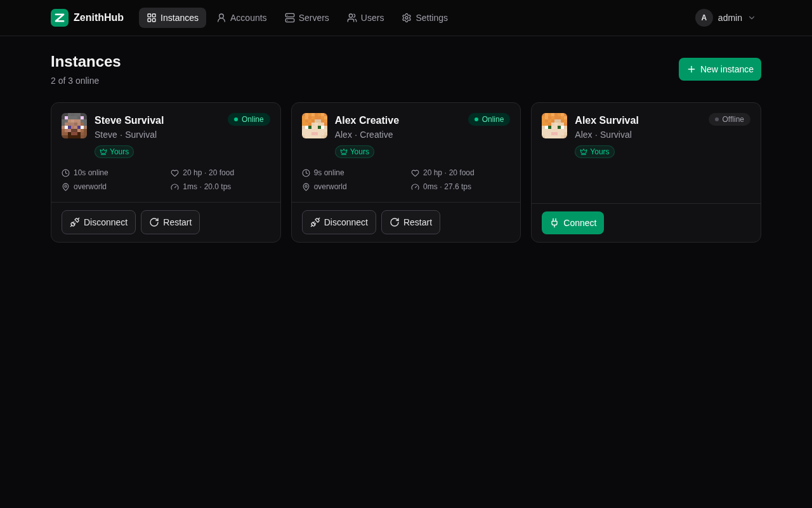
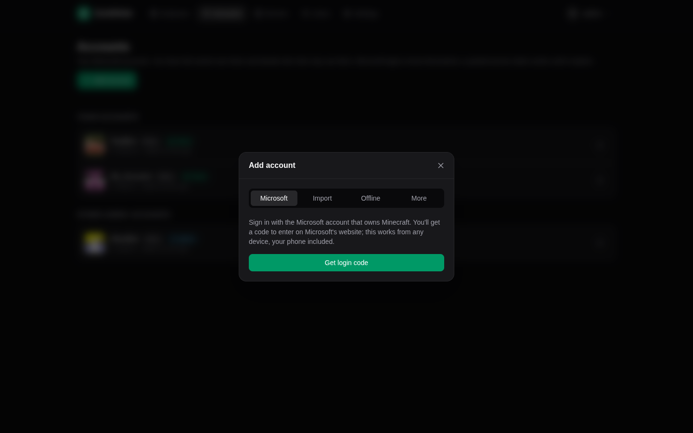
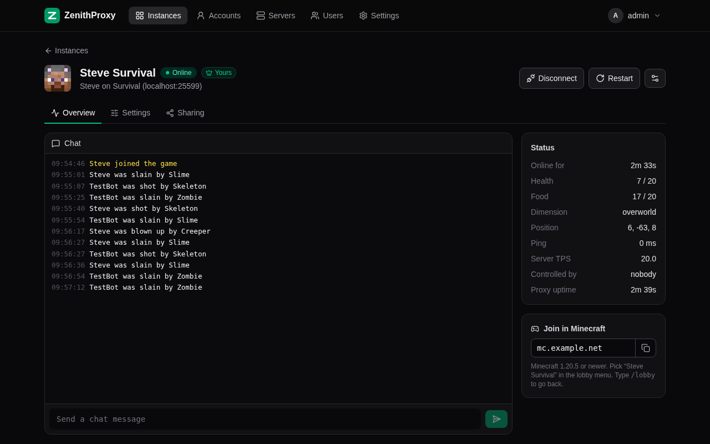
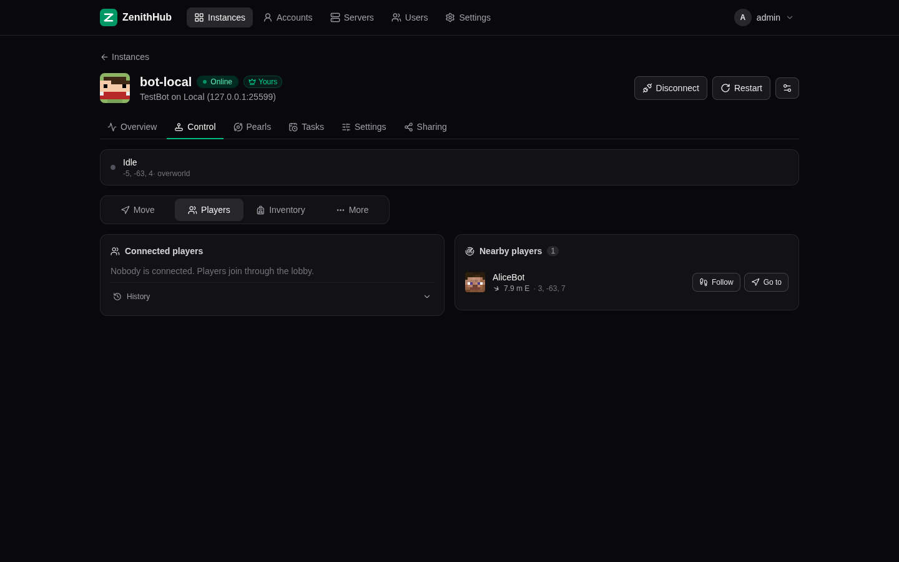
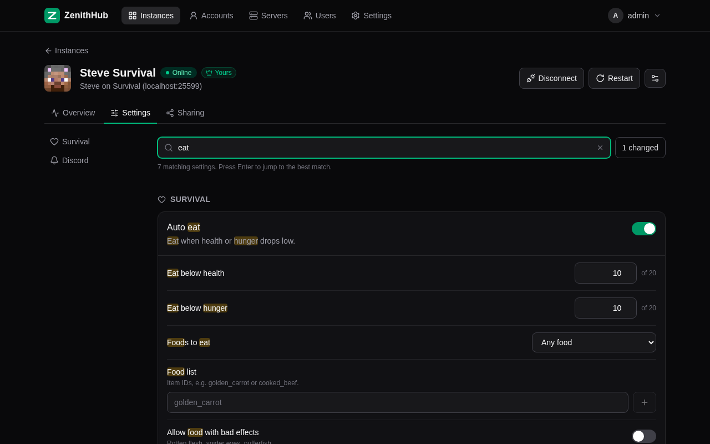
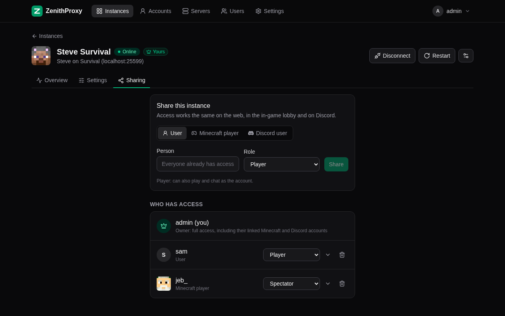
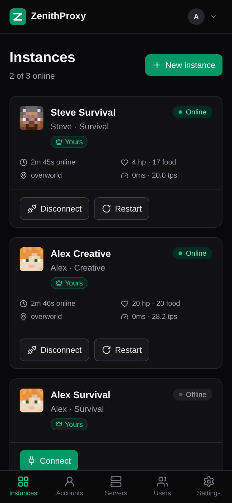
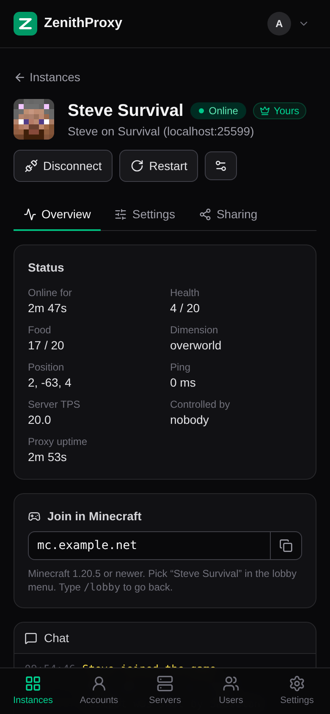

# ZenithHub

Run many Minecraft accounts from one Docker container and one web UI. ZenithHub is a hard fork of
[ZenithProxy](https://github.com/rfresh2/ZenithProxy).

ZenithProxy is a Minecraft bot that players can also log into and control in-game. It keeps accounts
online around the clock and lets you share them with friends without sharing passwords. It was built
for [2b2t.org](https://www.2b2t.org/) but works on any server.

ZenithHub runs one ZenithProxy per account and server and wraps them in a manager. You never edit
config files or type commands: adding an account, connecting it to a server, sharing it and changing
settings all happen in the browser.



## What ZenithHub adds

- **Web UI** to add accounts, add servers, and connect, disconnect or watch every bot. Works on phones.
- **Accounts without a terminal:** Microsoft device-code login with one click, auth-cache import or
  offline. Under **More**: a login.live.com cookie export, a Microsoft refresh token or a Minecraft
  access token. Tokens are refreshed in the background.
- **Instances:** each instance is an account on a server. One account can be on several servers at once.
- **Control without commands:** a Control tab for movement (go to, follow, mine, fly and more),
  waypoints, clicking and looking, the inventory and open containers, connected players (kick, make
  player, make spectator, connection history), nearby players, requeue, transfers and replay
  recording. A Pearls tab loads stasis pearls, and a Tasks tab runs any action later, on a schedule,
  at a time of day, or when something happens: a stranger comes into view, health drops, a totem
  pops, the bot leaves the AFK zone or stops earning, arrives somewhere, or nobody has played for a
  while. "Notify me" sends you an alert in the browser and on Discord.
- **Clean settings:** curated pages instead of commands for every Zenith setting, layered
  Global → Server → Instance, with search, a "changed" filter, reset to inherited and an
  "advanced" toggle for the rarely used ones. Settings apply live.
- **One Minecraft port with a lobby:** players join a single address and get a chest menu of the bots
  they may use. Click to play, right-click to spectate, `/lobby` to go back. Clients from 1.20.5 to
  the newest version ViaVersion supports can join.
- **Any server version:** Zenith runs natively on Minecraft 26.3 and uses ViaVersion to join each
  server at the newest version it supports, so menus and dialogs reach new clients untranslated.
- **Looks like a vanilla client:** fresh-install client settings, vanilla chat signing and
  acknowledgements, real resource-pack downloads, cookies and transfers. Extra privacy switches
  (block cookies, refuse local resource packs, answer translation-key probes like vanilla and more)
  are under Settings → Privacy.
- **Users and sharing:** one admin, users with their own accounts and private servers, and sharing
  by Minecraft name or Discord user with role presets. One permission system covers the web, the
  lobby and Discord.
- **Optional central Discord bot:** a single bot token for everything. It creates a category per
  account and a channel per instance, posts Zenith's notification embeds and pings the owner. It
  has `/status`, `/connect`, `/disconnect`, `/pearl` and `/command`, and every notification can be
  switched off. There is no chat relay.
- **Outbound proxy** (SOCKS/HTTP) for all traffic: the server connection, Microsoft and Xbox sign-in,
  skins and every other request. One global proxy, optionally with per-user proxies, or a proxy pool
  that gives every account its own IP from a provider's list (Webshare and the like).
- **AFK zones** on plugin servers like HugoSMP: keeps the bot in the zone, and shows whether it's
  actually earning, the reward over time and every stay.
- **Optional cheat lock:** `ZENITH_DISABLE_CHEATS=true` removes combat and automation modules for
  servers that don't allow them.
- Instances return to their previous state after a restart and are restarted with backoff if they crash.

Deleted compared to upstream: Zenith's own per-instance Discord bot and its Discord commands, the
Discord chat relay, the interactive terminal, the self-updater and its commands, the Python
launcher, the VPS install scripts, the release workflows and the setup guides in the wiki. Updates
come from new Docker images.

## Quickstart

You need a Linux machine with [Docker](https://docs.docker.com/engine/install/) and an x86-64-v3 CPU
(most CPUs from 2015 onwards). For ARM, see [Building it yourself](#building-it-yourself).

**1. Start it.**

```sh
mkdir zenithhub && cd zenithhub
curl -O https://raw.githubusercontent.com/jkramer5103/ZenithHub/main/quickstart/docker-compose.yml
docker compose up -d
```

**2. Create the admin account.** Open `http://<host>:8080`. The first visit asks for a username and
password.

**3. Set the public address.** Under Settings → General, enter the address players type in
Minecraft, for example `mc.example.net` or your server's IP.

**4. Add a Minecraft account.** Accounts → Add account → Get login code. Enter the code on
Microsoft's page from any device. Nothing is typed into a terminal.



**5. Add a server and connect.** Servers → Add server with `2b2t.org` (or any server), then Instances → New
instance, pick the account and the server, and press Connect.

**6. Join in Minecraft.** Connect to the public address on port 25565. The lobby shows a chest menu
of the bots you may use: click to play, right-click to spectate, type `/lobby` to go back.

### Updating

```sh
docker compose pull && docker compose up -d
```

Images are tagged `latest` and `sha-<commit>`. All data (state, accounts, instance folders, secrets)
lives in `./data`, next to the compose file. Serve the web UI over HTTPS by putting it behind your
own reverse proxy.

## Screenshots

Each instance shows its status, chat and how to join:



The Control tab replaces Zenith's commands: movement, players, inventory and more, each one tap away:



Settings are curated pages with search, instead of commands:



Share an instance with a user, a Minecraft player or a Discord user. Access works the same on the
web, in the lobby and on Discord:



It works on phones too:

<p>
  
  
</p>

## Building it yourself

The `docker-compose.yml` in the repo root builds the image from your checkout:

```sh
git clone https://github.com/jkramer5103/ZenithHub.git
cd ZenithHub
docker compose up -d --build
```

By default Zenith is compiled to a GraalVM native binary, which needs an x86-64-v3 CPU. On ARM or
older CPUs, set the build argument `ZENITH_RUNTIME: jar` in `docker-compose.yml`. Zenith then runs
on the JVM and uses more memory per instance.

## Environment variables

| Variable | Default | Meaning |
|---|---|---|
| `ZENITH_DATA_DIR` | `/data` | State, accounts, instances and secrets |
| `ZENITH_WEB_PORT` / `ZENITH_WEB_BIND` | `8080` / `0.0.0.0` | Web UI and API |
| `ZENITH_LOBBY_PORT` | `25565` | Public Minecraft port (lobby and router) |
| `ZENITH_INSTANCE_PORT_BASE` / `ZENITH_CONTROL_PORT_BASE` | `30000` / `40000` | Localhost ports for instances |
| `ZENITH_LOBBY_ONLINE_MODE` | `true` | Set to `false` only for local testing |
| `ZENITH_DISABLE_CHEATS` | off | Set to `true` to turn off cheats for every instance (see below) |

With `ZENITH_DISABLE_CHEATS=true`, these modules are off, their settings are hidden and their commands
don't exist: KillAura, SpawnPatrol, TickRate, AutoTotem, AutoArmor, AutoMend, Spook, AntiAFK,
AutoFish, AutoEat, AutoOmen, AutoDrop, AutoRespawn, Spammer and AutoReply. Pathfinder (Baritone),
PearlLoader, AutoDisconnect, VisualRange, Tasks and spectating stay available. Settings people had
for those modules come back when the variable is removed.

## How it works

```
browser ──► manager (Java)  ── web UI + REST/WebSocket API, users and grants,
 :8080        │                accounts, supervisor, lobby + router, Discord bot
MC client ──► │ localhost control API
 :25565       ▼
            zenith × N  ── one process per instance, in /data/instances/<id>
```

- `manager/`: the manager, a Gradle subproject (Java 25, Javalin, MCProtocolLib, ViaVersion).
- `web/`: the UI (SvelteKit static build, Tailwind), served by the manager.
- `src/`: ZenithProxy itself. With `ZENITH_MANAGED=1` it runs in managed mode
  (`com.zenith.control`): a localhost control API and no terminal, Discord bot or updater.

The full design is in [docs/revamp/PLAN.md](docs/revamp/PLAN.md).

## Development

Gradle installs the required Java version (Java 25).

```sh
./gradlew :shadowJar :manager:shadowJar   # build/libs/ZenithProxy.jar, manager/build/libs/zenith-manager.jar
./gradlew :manager:test
cd web && npm ci && npm run build          # web/build
cd web && npm run check                    # type-check the UI
```

To run the manager locally, point it at the jar and the built UI:

```sh
ZENITH_DATA_DIR=./data ZENITH_WEB_DIR=web/build ZENITH_LOBBY_ONLINE_MODE=false \
ZENITH_COMMAND="java -jar build/libs/ZenithProxy.jar" \
  java -jar manager/build/libs/zenith-manager.jar
```

## Credits and license

All of the bot itself comes from [rfresh2/ZenithProxy](https://github.com/rfresh2/ZenithProxy) and its
contributors. The upstream [wiki](https://wiki.2b2t.vc/) documents what each module does.

Licensed under the [AGPL-3.0](LICENSE), like upstream. See [README-LICENSE.md](README-LICENSE.md).
